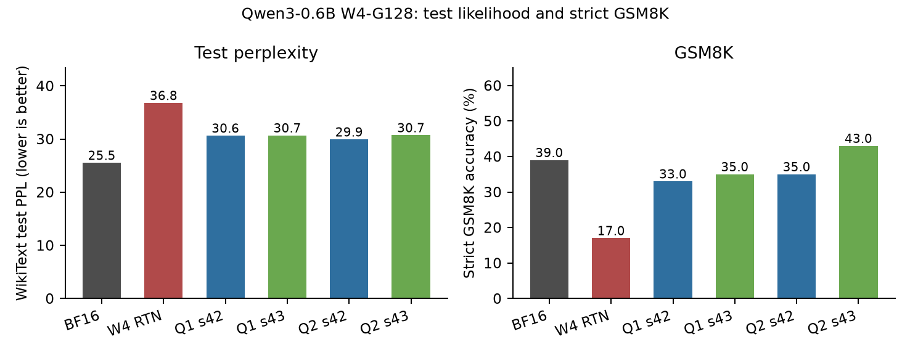
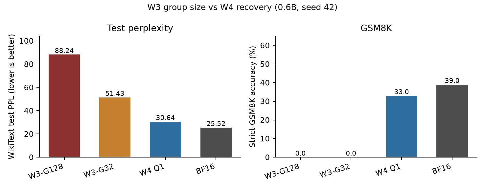
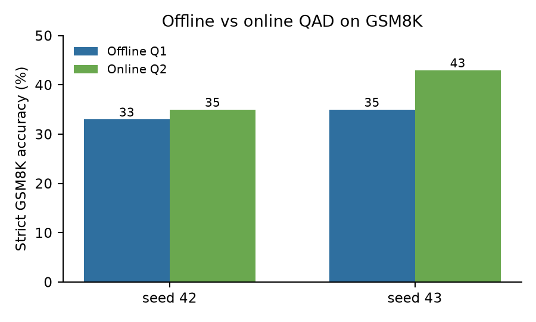
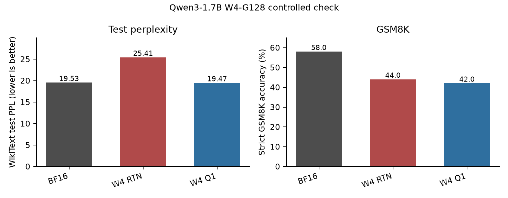

# Low-Bit Quantization & Quantization-Aware Distillation for Qwen3

**Aggressive weight quantization, offline distillation, and on-policy QAD on Qwen3-0.6B and Qwen3-1.7B.**

The goal is to investigate two questions:

1. **How much model quality can quantization-aware distillation (QAD) recover after aggressive W3/W4 weight quantization?**
2. **Does training on the quantized student's own generated trajectories improve recovery compared with offline distillation?**

We implemented a weight-only fake-quantization and distillation pipeline, evaluated multiple quantization granularities, ran matched offline/on-policy experiments across two seeds, and investigated cases where lower perplexity did not translate into better generation.

**Central finding:** QAD can recover substantial quantization-induced likelihood degradation, but recovering teacher-forced token distributions does not necessarily restore autoregressive reasoning or generation quality.

[**Full Research Report**](reports/FINAL_RESEARCH_REPORT.md) · [W3 Failure Analysis](reports/w3_failure_analysis.md) · [Experiment Registry](experiments/index.md) · [Correctness Audit](reports/final_audit.md)

---

## Key Research Results

### 1. Low-Bit Quality Recovery

We evaluated symmetric weight-only quantization with group sizes 128 and 32, using a frozen BF16 teacher and offline forward-KL distillation.

| Model | Quantization | RTN Test PPL ↓ | After QAD ↓ | GSM8K After QAD ↑ |
|---|---|---:|---:|---:|
| Qwen3-0.6B | W4-G128 | 36.79 | **30.64–30.68** | **33–35%** |
| Qwen3-0.6B | W3-G128 | — | **88.24** | **0%** |
| Qwen3-0.6B | W3-G32 | 112.49 | **51.43** | **0%** |
| Qwen3-1.7B | W4-G128 | 25.41 | **19.47** | **42%** |

**BF16 references:**
- Qwen3-0.6B: 25.52 test PPL, 39% GSM8K.
- Qwen3-1.7B: 19.53 test PPL, 58% GSM8K.

*PPL is measured on the held-out WikiText-103 test set. GSM8K uses 100 fixed questions, non-thinking mode, and a frozen strict final-answer parser. The W4 0.6B ranges represent two training seeds. A dash denotes an unavailable directly comparable test measurement.*

At W4-G128, offline QAD substantially recovers both likelihood and task accuracy on the 0.6B model. At 1.7B, it restores test perplexity almost to the BF16 baseline, but does not demonstrate corresponding GSM8K recovery.



### 2. Aggressive W3: Likelihood Recovery Without Usable Generation

W3 was the main aggressive-quantization target.

**W3-G128:** Under the matched validation protocol, offline QAD reduced perplexity from **766.84 → 62.42**.

**W3-G32:** Reducing the group size substantially improved quality. After QAD, test perplexity reached **51.43**, compared with **88.24** for G128.

Despite this improvement, **both W3 configurations scored 0/100 on strict GSM8K** under the tested generation settings.

A deeper investigation of W3-G32 found:

- 31/100 responses terminated naturally, but **30 of those 31 terminated within 10 tokens**.
- Many prematurely terminated responses consisted of malformed `<think>`, `</think>`, or other control-token sequences.
- The remaining 69/100 responses reached the generation cap without a valid final answer.
- Training used OpenThoughts-style reasoning continuations, whereas the main evaluation used Qwen3's non-thinking chat format. This formatting mismatch is established, but its causal contribution to the W3 failure remains unproven.

**Research insight:** Improving local next-token likelihood is not sufficient evidence that a heavily quantized model can sustain coherent multi-token reasoning.



[Detailed W3 generation failure investigation](reports/w3_failure_analysis.md)

### 3. Offline vs. On-Policy QAD

We compared two distillation approaches:

- **Offline QAD (Q1):** Forward KL on fixed gold continuations.
- **On-policy QAD (Q2):** The current quantized student generates fresh rollouts after updates; the frozen teacher supervises the student on those same visited prefixes.

Both arms used identical prompt IDs at each training step, matched response-token budgets, the same optimizer and quantization configuration, and validation-based checkpoint selection.

**Qwen3-0.6B, W4-G128:**

| Seed | Offline Test PPL ↓ | Online Test PPL ↓ | Offline GSM8K | Online GSM8K |
|---|---:|---:|---:|---:|
| 42 | 30.64 | **29.92** | 33% | 35% |
| 43 | **30.68** | 30.72 | 35% | 43% |

On-policy QAD improved GSM8K accuracy by +2 and +8 percentage points across the two seeds, but neither paired result established a statistically significant advantage:

- Seed 42: 95% paired CI [−4, +9] percentage points; McNemar p = 0.77.
- Seed 43: 95% paired CI [−2, +19] percentage points; McNemar p = 0.17.

Held-out perplexity was nearly tied, while online QAD required additional compute for rollout generation.

**Conclusion:** Under the tested 128-token rollout and forward-KL regime, an on-policy advantage remains unproven.



### 4. Scaling Check: Qwen3-1.7B

We also tested whether W4 offline-QAD recovery transfers to a larger Qwen3 model.

| Variant | Test PPL ↓ | GSM8K ↑ |
|---|---:|---:|
| BF16 teacher | 19.53 | **58%** |
| W4-G128 RTN | 25.41 | 44% |
| W4-G128 offline QAD | **19.47** | 42% |

Offline QAD recovered test perplexity to approximately BF16 quality. However, GSM8K remained substantially below the teacher, and its 2-point difference from the RTN baseline is inconclusive on 100 questions.

This is a second observation of the **likelihood-versus-task-quality gap**, now at a different model size.



---

## Implementation

The research pipeline is implemented primarily in PyTorch and Hugging Face Transformers.

| Component | Implementation |
|---|---|
| Weight quantization | Symmetric W3/W4, per-group quantization, configurable group sizes |
| Quantization-aware training | FP32 master weights with straight-through estimator (STE) |
| Model coverage | 196 quantized linear projections; embeddings, norms, and tied LM head excluded |
| Offline distillation | Frozen-teacher forward KL on gold continuation tokens |
| On-policy distillation | Fresh student-generated rollouts, followed by teacher/student KL on identical visited prefixes |
| Training | AdamW, gradient accumulation over examples, validation-selected best checkpoints |
| Evaluation | Held-out NLL/PPL, teacher–student KL, strict GSM8K, generation diagnostics |
| Reproducibility | Pinned revisions, fixed prompt schedules, checkpoint hashes, per-example generations, integrity tests |

**Core implementation:**

- [Quantization and fake-quantized linear layers](src/qwen_qad/quantization.py)
- [Matched offline/on-policy training](scripts/train_matched.py)
- [Student rollout generation](src/qwen_qad/rollouts.py)
- [KL loss and token masking](src/qwen_qad/losses.py)
- [Strict GSM8K evaluation](scripts/eval_gsm8k_strict.py)
- [Matching and reproducibility checks](src/qwen_qad/matching.py)

The symmetric reference quantizer uses integer ranges **[−3, 3] for W3** and **[−7, 7] for W4**, with per-group scales. These conventions are explicitly defined rather than assumed to match every hardware quantization format.

## Experimental Protocol

- **Models:** Qwen3-0.6B and Qwen3-1.7B, pinned to exact Hugging Face revisions.
- **Training data:** OpenThoughts prompts and gold continuations.
- **Validation:** 128 FineWeb-Edu blocks, used for checkpoint selection.
- **Final test:** 128 separate WikiText-103 blocks, approximately 131K scored tokens.
- **Generation benchmark:** First 100 fixed GSM8K test questions, strict non-thinking evaluation.
- **Matched W4 runs:** 200 optimizer steps, 32 prompts per step, 128-token continuation cap, 6,400 prompt instances, seeds 42 and 43.
- **Hardware:** RTX A5000 (24 GB) for 0.6B; RTX A6000 (48 GB) for 1.7B.

Experiments record quantization settings, model revisions, training budgets, memory measurements, checkpoint selection, evaluation metrics, and per-example generation outputs.

The parser and experimental methodology were audited and corrected during development. Historical results are preserved separately; the findings above use the corrected protocol.

[Experiment registry](experiments/index.md) · [Final correctness audit](reports/final_audit.md) · [Data split manifest](data/manifests/gate8_splits_manifest.json)

---

## Reproduction

### Environment

Python 3.12 and a compatible CUDA/PyTorch environment are recommended for the GPU experiments.

```bash
git clone https://github.com/awesome-pro/qad.git
cd qad

uv venv --python 3.12 .venv
uv pip install --python .venv/bin/python -e ".[dev]"
```

### Prepare data

Requires access to the pinned public Hugging Face datasets.

```bash
.venv/bin/python scripts/prepare_data.py
.venv/bin/python scripts/prepare_splits.py
```

### BF16 and quantized baselines

```bash
.venv/bin/python scripts/baseline.py \
  --variant T0 \
  --device cuda \
  --eval data/cache/eval/wikitext_test_ids.npy \
  --out /tmp/t0.json

.venv/bin/python scripts/baseline.py \
  --variant Q0 \
  --bits 4 --group-size 128 \
  --device cuda \
  --eval data/cache/eval/wikitext_test_ids.npy \
  --out /tmp/q0.json
```

### Matched offline and on-policy QAD

```bash
for ARM in q1 q2; do
  .venv/bin/python scripts/train_matched.py \
    --arm "$ARM" \
    --bits 4 --group-size 128 \
    --steps 200 --prompts-per-step 32 \
    --continuation-cap 128 --seed 42 \
    --val-set data/cache/eval/fineweb_val_ids.npy \
    --run-name "${ARM}_w4_s42" \
    --out-dir experiments/gate8 \
    --checkpoint-dir checkpoints
done
```

See the [GPU reproduction guide](docs/gpu_guide.md) for model-specific commands, checkpoint evaluation, integrity checks, and hardware requirements.

### Tests

```bash
.venv/bin/python -m pytest -q
```

Last recorded audit: **173 passed, 2 environment-dependent skips**.

---

## Limitations and Future Research

This is an **experimental research pilot**, not a production inference engine or a completed open-weight deployment.

Important limitations:

- **Fake quantization:** Training retains FP32 master weights. No packed INT3/INT4 checkpoint, inference memory saving, or serving speedup is claimed.
- **Statistical uncertainty:** Two matched W4 seeds, one seed for W3/1.7B, and a 100-question GSM8K subset.
- **Training/evaluation differences:** The original OpenThoughts reasoning format differs from Qwen3's native thinking/non-thinking chat format.
- **W3 failure attribution:** Severe generation problems are observed, but the contributions of quantization damage, data formatting, and decoding have not been causally isolated.
- **Algorithm scope:** The on-policy method uses forward KL on student-visited prefixes; it is not an exact reproduction of all published OnlineQAT objectives.
- **Artifact scope:** Some historical model weights are unavailable, although the associated experiment logs and results are preserved.

**Promising next research questions:**

1. Can stronger W3 initialization, such as GPTQ/AWQ or block-wise QAT, preserve useful generation?
2. Can Qwen-native training targets prevent control-token failure under aggressive quantization?
3. Do longer on-policy trajectories or alternative distillation objectives improve generative recovery beyond teacher-forced KL?

These are proposed directions, **not experiments claimed to have been completed**.

---

## Repository Guide

| Location | Contents |
|---|---|
| [`reports/FINAL_RESEARCH_REPORT.md`](reports/FINAL_RESEARCH_REPORT.md) | Complete experimental findings, methodology, comparisons, and limitations |
| [`reports/w3_failure_analysis.md`](reports/w3_failure_analysis.md) | Detailed investigation of W3 generation failures |
| [`reports/figures/`](reports/figures/) | Results visualizations generated from canonical JSON |
| [`reports/final_audit.md`](reports/final_audit.md) | Correctness, evaluation integrity, and methodological checks |
| [`experiments/`](experiments/) | Training logs, results, generation records, and provenance |
| [`reports/checkpoint_inventory.md`](reports/checkpoint_inventory.md) | Checkpoint availability and verified backups |
| [`src/qwen_qad/`](src/qwen_qad/) | Quantizer, distillation losses, model integration, and rollout logic |
| [`scripts/`](scripts/) | Training, evaluation, diagnostics, and reproducibility commands |
| [`tests/`](tests/) | Unit and integration tests |
| [`docs/research_brief.md`](docs/research_brief.md) | Original research specification |
| [`reports/archive/`](reports/archive/) | Historical pilot reports preserved for traceability |

**Research takeaway:** Effective aggressive quantization requires more than recovering next-token likelihood. Preserving stable generation, reasoning behavior, and model-specific control-token structure may be equally important.