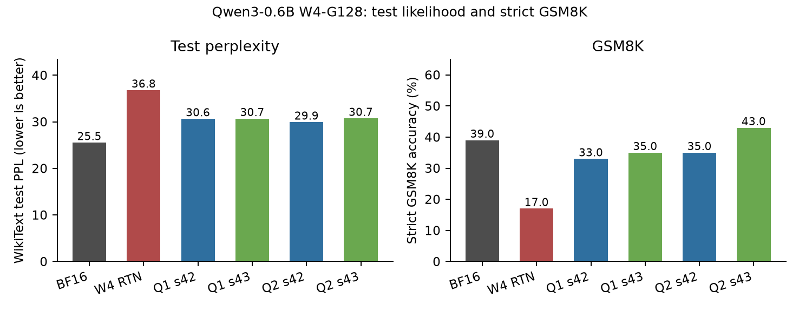
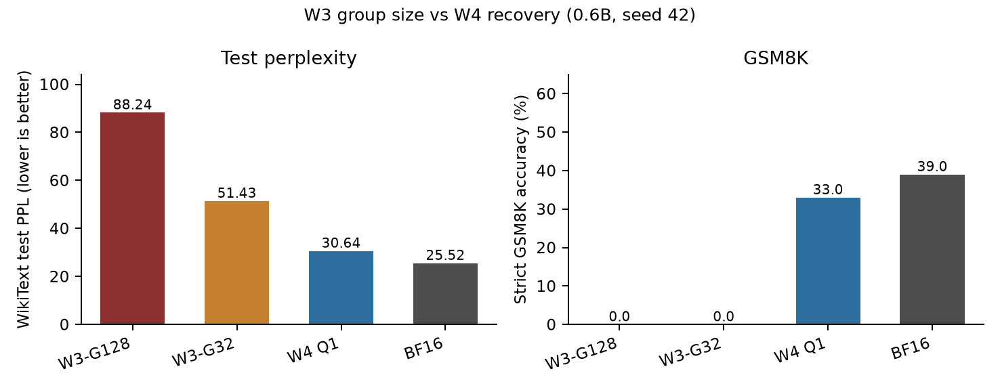
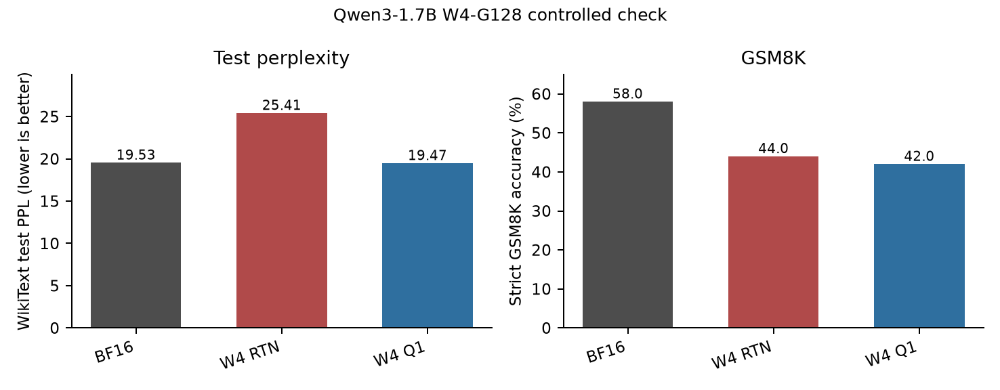
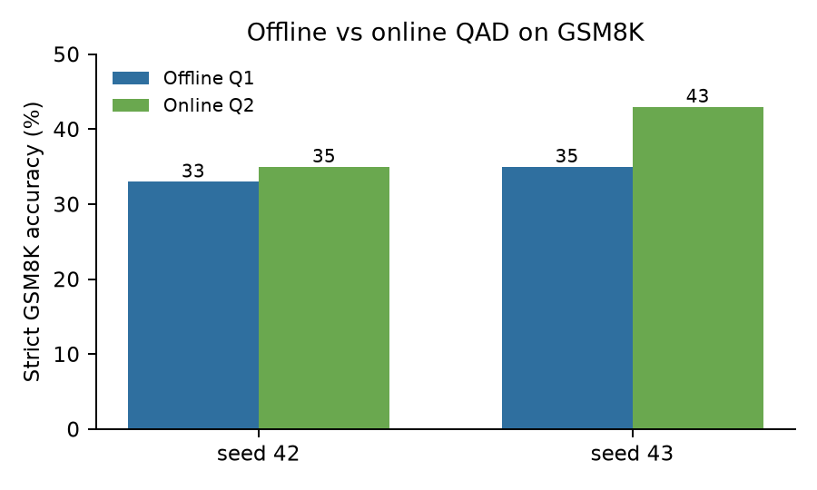

# Low-bit QAD for Qwen3: final research report

## 1. Executive summary

This project asked whether quantization-aware distillation (QAD) can recover
useful behavior after aggressive weight quantization of Qwen3, and whether
on-policy distillation beats a matched offline baseline.

We implemented symmetric fake quantization for all quantizable linear
projections, FP32 master weights with a straight-through estimator, and
teacher-forced forward-KL distillation. We compared BF16, post-training
round-to-nearest (RTN), offline QAD on gold completions, and on-policy QAD on
fresh student rollouts under matched prompt schedules. We ran W4-G128 on
Qwen3-0.6B with two seeds, W3-G128 and W3-G32 on 0.6B, and a controlled
W4-G128 check on Qwen3-1.7B.

Main findings:

- **Offline QAD reliably recovers much of the W4 quantization damage.** On
  0.6B it moves WikiText test perplexity from 36.8 (RTN) to about 30.7, close to
  BF16 25.5, and improves strict GSM8K from 17% to 33–35% (BF16 39%).
- **On-policy QAD has no statistically established advantage.** It is tied on
  test likelihood and its GSM8K differences (+2 and +8 points across seeds)
  have confidence intervals that include zero. It also costs additional rollout
  compute.
- **W3 remains unusable for generation.** W3-G128 QAD reaches 88.2 test PPL but
  0% GSM8K; smaller groups help likelihood substantially (W3-G32: 51.4 test
  PPL) but generation still fails with premature control-token termination.
- **Likelihood and task quality dissociate.** At 1.7B, offline QAD restores test
  PPL to 19.47, essentially BF16's 19.53, while GSM8K is 42% versus 44% for RTN
  and 58% for BF16.
- The strongest next question is **how to initialize aggressive quantization**
  (GPTQ/AWQ or block-wise QAT), not more QAD steps or more benchmarks.

## 2. Experimental setup

**Models.** Qwen3-0.6B (`c1899de289a04d12100db370d81485cdf75e47ca`) and
Qwen3-1.7B (`70d244cc86ccca08cf5af4e1e306ecf908b1ad5e`). BF16 teacher, separate
student initialized from the same checkpoint.

**Quantization.** Symmetric signed per-group quantization of all quantizable
`nn.Linear` weights, with FP32 master weights and identity STE. W4 codes
−7…7; W3 codes −3…3. Exactly 196 projection modules are quantized; the tied
LM head is excluded. Scales are computed in FP32 during training, one scale per
group of 128 or 32 weights; the packed-size accounting's FP16 scale is a
storage model, not the training dtype. Embeddings and norms are not quantized. This is **fake
quantization**: it measures accuracy, not packed INT3/INT4 speed.

**Distillation.** Forward KL(teacher‖student) on response tokens only, with the
LM head applied in chunks; gradients are accumulated per example and one
optimizer step is taken per training step; no cross-entropy term. Offline
Q1 uses gold OpenThoughts completions truncated to 128 tokens. On-policy Q2
generates fresh student rollouts each step (temperature 0.6, top-p 0.95,
top-k 20, 128 new tokens), then applies the same forward KL. Q2 is forward KL on
student-generated prefixes; it is not an exact reproduction of every OnlineQAT
algorithm.

**Matched protocol.** Q1 and Q2 use the same 3,000-prompt schedule, identical
prompt IDs per step, 32 prompts/step, 128-token continuation cap, 200 steps,
AdamW (lr 1e-5, warmup 20, cosine), same teacher, quantizer and seed.
Best checkpoints are selected on validation NLL only.

**Data.** Training: OpenThoughts prompts/completions (2,979/3,000 truncated at
1,024 tokens; EOS only on 21 complete responses). Validation: first 128 blocks
of FineWeb-Edu. Final test: 128 disjoint WikiText-103 test blocks. Block-hash
overlap is zero. WikiText is a public benchmark and contamination is possible.

**Hardware.** 0.6B on RTX A5000 24 GB; 1.7B on RTX A6000 48 GB. Measured peak
memory and checkpoint sizes are in the run JSONs; theoretical packed sizes are
in `reports/memory_accounting.md` and are not deployment measurements.

## 3. Main results

### Qwen3-0.6B, W4-G128

| Variant | Test PPL | Strict GSM8K |
|---|---:|---:|
| BF16 | 25.52 | 39% |
| W4 RTN | 36.79 | 17% |
| Offline QAD, seed 42 | 30.64 | 33% |
| Offline QAD, seed 43 | 30.68 | 35% |
| Online QAD, seed 42 | 29.92 | 35% |
| Online QAD, seed 43 | 30.72 | 43% |

Paired offline vs online: seed 42 **+2 points**, 95% CI [−4, +9], McNemar
p=0.77; seed 43 **+8 points**, CI [−2, +19], p=0.17. Likelihood is tied. Online
QAD does not show an established advantage and uses extra rollout compute.

### W3 experiments

| Run | Val PPL | Test PPL | Strict GSM8K |
|---|---:|---:|---:|
| W3-G128 Q0 (matched protocol) | 766.84 | — | — |
| W3-G128 QAD | 62.4 | 88.2 | 0% |
| W3-G32 Q0 | 97.7 | 112.5 | — |
| W3-G32 QAD | 40.8 | 51.4 | 0% |
| W4 QAD (reference) | 26.6 | 30.7 | 33–35% |

Smaller groups improve likelihood substantially but do not restore generation.
The W3-G32 failure is dominated by premature control-token termination: 30 of
31 completed responses ended within 10 tokens, 99% contained control markers,
and 99% had no final answer. See `reports/w3_failure_analysis.md`.

### Qwen3-1.7B, W4-G128

| Variant | Test PPL | Strict GSM8K |
|---|---:|---:|
| BF16 | 19.53 | 58% |
| W4 RTN | 25.41 | 44% |
| Offline QAD | 19.47 | 42% |

Near-BF16 test perplexity does **not** imply recovered reasoning accuracy. The
1.7B run used max sequence length 1,536 and is offline-only, single-seed.

## 4. Main scientific findings

1. **Offline QAD meaningfully recovers low-bit damage** at W4 on both model
   sizes, on held-out likelihood and (at 0.6B) partially on GSM8K.
2. **On-policy forward-KL QAD has no established advantage** under the tested
   conditions. The +2/+8 GSM8K pattern is seed-dependent, and test likelihood
   is tied.
3. **Reducing W3 group size improves likelihood but not generation.** G32
   halves test PPL relative to G128 and still scores 0% GSM8K.
4. **Teacher-forced likelihood and generative quality diverge.** The 1.7B
   student matches BF16 test PPL but not GSM8K.
5. **Aggressive W3 shows malformed thinking/control-token behavior and
   premature termination**, not merely noisy text.

## 5. Limitations

- Two matched seeds for 0.6B W4; single seed for W3 and 1.7B.
- 100 GSM8K examples per run; confidence intervals are wide.
- Thinking-mode subsets (10 questions) are diagnostics, not accuracy.
- Fixed 128-token training continuations; gold OpenThoughts data is truncated
  and its control-token format differs from Qwen's chat format.
- No causal isolation of the W3 generation failure (quantization vs data
  formatting vs decoding).
- Fake quantization; no packed artifact, no vLLM speed measurement.
- Checkpoint availability is incomplete: seed-43 and W3-G128 weights were lost
  with an old pod; only results remain.
- Results do not automatically generalize to larger models or other
  quantizers.

## 6. Proposed future research

Hypotheses, not established results:

- **Stronger W3 initialization** (GPTQ/AWQ, then block-wise QAT) is the most
  promising route to aggressive quantization that preserves generation.
- **Preserve chat/thinking-control behavior** under aggressive quantization;
  rebuilding training targets in Qwen-native thinking format is a targeted
  test.
- **Longer or alternative on-policy objectives** may be needed before online
  QAD can show an advantage.
- **Packed INT3/INT4 export and serving validation** are required before any
  deployment claim.

## 7. Reproduction and artifacts

- Environment/setup: `README.md`, `docs/parser_spec_v3.md`,
  `docs/gpu_guide.md`.
- Strict GSM8K evaluator: `scripts/eval_gsm8k_strict.py` (frozen v3.0.0).
- Matched training: `scripts/train_matched.py`; matching check:
  `scripts/check_matched.py`.
- Data splits: `data/manifests/gate8_splits_manifest.json`.
- Result integrity: `experiments/gate8/regraded_v3/integrity_report*.json`.
- Final audit: `reports/final_audit.md`.
- Checkpoint inventory: `reports/checkpoint_inventory.md`.
- Historical reports remain in `reports/archive/` and are labelled where superseded.
